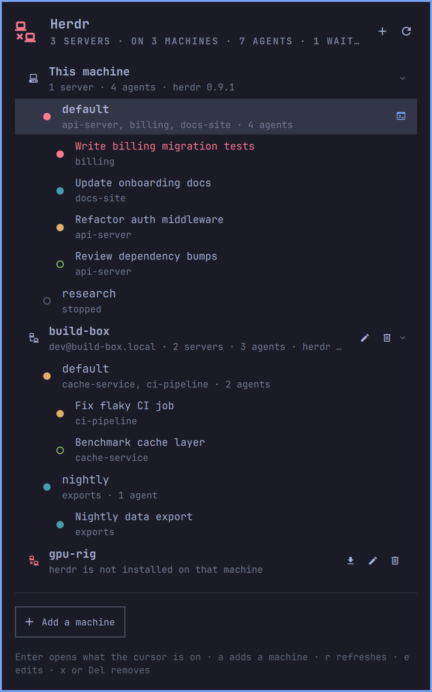

# Herdr

**The only herdr plugin you need.** Every herdr server you work on, on this
machine and on the machines you reach over SSH, in the bar, with the agents
inside them and a click that lands you on the one you picked.

An [Omarchy](https://omarchy.org/) bar plugin for [herdr](https://herdr.dev).
Herdr runs one server per named session, on every machine you use, and closing
a window only detaches from it, so servers pile up unseen. The ones on another
machine were never visible from here at all. This widget puts the count in the
bar and the whole herd one click away. It shows what herdr knows and takes you
there. It never stops a server, never deletes a session, has two refresh
intervals and no other settings, and needs nothing Omarchy does not already
ship.

## What it gives you

- **Every machine in one list.** This machine first, then each machine you
  add over SSH, each with its sessions and the agents inside them. A machine
  that cannot be reached says why on its own row.
- **A badge for the agent waiting on you.** The count in the corner of the
  icon is how many agents are blocked on an answer, or else how many finished
  while you were elsewhere, or else how many are still working. An idle herd
  shows no badge at all.
- **herdr's own colours.** Blocked, done, working and idle are drawn exactly
  as herdr draws them in its sidebar: its theme, its overrides, and with the
  `terminal` theme your Omarchy theme's palette. Idle is a hollow ring, the
  rest are dots, or herdr's symbols if you set herdr to use them.
- **One click to the work.** A session that already has a window gets that
  window raised on its workspace. One without gets a terminal opened on it,
  locally or over SSH. Clicking an agent focuses its pane first.
- **Adding a machine is a form, with a Test button.** It says whether ssh gets
  there, whether herdr is installed, which version, and whether a server is
  already running, before anything is saved. If herdr is missing over there,
  one button runs herdr's own installer in a terminal you can watch.
- **Keyboard everything.** The panel never needs the mouse.



## Install

```bash
omarchy plugin add https://github.com/Majkelll/omarchy-herdr.git --enable
```

Click the icon in the bar. This machine's herdr shows up straight away; other
machines are added from the panel.

### Removing it

```bash
omarchy plugin remove io.github.majkelll.herdr
```

That unloads the widget and deletes the plugin. Your machine list stays in
`~/.config/omarchy-herdr/` in case you come back. Delete that directory, and
`~/.cache/omarchy-herdr/` with its SSH connection sockets, to remove every
trace. No herdr server, session or agent is touched by removing the plugin.

## The panel

One list, top to bottom:

| Row | What it shows |
|---|---|
| **A machine** | its ssh target, how many servers and agents it holds, and its herdr version. Click it to fold its sessions away. |
| **A session** | its name, the projects open in it, how many agents it holds. Bold with a terminal glyph when a window is already showing it. |
| **An agent** | what it is doing, from its terminal title, with herdr's mark for its state. The mark of whichever agent started waiting since the last refresh pulses, so the sound herdr just played has a face. |

### What a click does

| You click | What happens |
|---|---|
| A session that has a window | its workspace is switched to and the window focused. Nothing is launched. |
| A session without one | a terminal opens on it: `herdr` locally, `ssh -t <machine> <herdr>` for a remote one, so the client and the server over there are always the same build. |
| An agent | its pane is focused inside that server first, then as above, so the window comes up on the work you were reading. |

## Adding a machine

Press `+` in the panel, or `a`, and fill in the host: a name, an address, or
an alias from `~/.ssh/config`. Port, user, identity file, the path to herdr
over there and the connect timeout are optional, under **More options**.

You need working key-based SSH access first. If `ssh <host>` asks for a
password, this widget will not get in either: it polls in the background, where
nothing can answer a prompt.

The list lives in `~/.config/omarchy-herdr/machines.json` and can be edited by
hand; the panel reloads it as it is saved. While the file does not parse, the
panel says so and refuses to write over it.

## Colours

The badge and every mark use the colour herdr gives that state: blocked is
herdr's red, done its teal, working its yellow, idle its green. They are read
from `~/.config/herdr/config.toml`: the `[theme]` name, `auto_switch` with
its dark and light names, and `[theme.custom]` overrides. With the `terminal`
theme the colours are your terminal's palette, which on Omarchy is the current
theme. A colour that would not show on the panel's background is moved just far
enough to be seen. Switching either theme takes effect without a restart.

## Keyboard

| Key | Does |
|---|---|
| `↑` `↓` / `j` `k` | move the cursor |
| `Enter` | land on the row under the cursor, or fold a machine |
| `a` | add a machine |
| `e` | edit the machine under the cursor |
| `x` or `Del` | remove it, twice: the second press confirms |
| `r` | refresh now |
| `Esc` | close the form, then the panel |

## Commands

```bash
omarchy-shell io.github.majkelll.herdr toggle            # open or close the panel
omarchy-shell io.github.majkelll.herdr list              # one line, e.g. "2 servers · on 2 machines · 5 agents · 1 waiting on you"
omarchy-shell io.github.majkelll.herdr refresh           # ask every machine now
omarchy-shell io.github.majkelll.herdr jump <machine> <session>
```

In `~/.config/hypr/bindings.conf`:

```
bindd = SUPER SHIFT, A, Herdr, exec, omarchy-shell io.github.majkelll.herdr toggle
```

## Settings

Set these on the widget's entry in `~/.config/omarchy/shell.json`, or through
Setup > Plugins.

| Key | Default | Meaning |
|---|---|---|
| `refreshSec` | `15` | How often every machine is asked while the panel is closed. An idle herd is asked half as often. |
| `openRefreshSec` | `4` | How often while the panel is open. |

Each refresh is one SSH round trip per machine, on a connection kept open
between polls in this widget's own cache directory, so it neither disturbs nor
depends on your `~/.ssh/config`. Every machine is asked at once, and one that
is down costs at most three of its own connect timeouts. With a bar on more
than one monitor, only one copy of the widget polls.

## Requirements

- [Omarchy](https://omarchy.org/) with `omarchy-shell` (the Quickshell bar).
- [herdr](https://herdr.dev) on this machine, the machines you add, or both.
- `jq`, `ssh`, `ps` and coreutils `timeout`, all part of a base Omarchy
  install. The remote machines need `bash` and nothing else.

## Privileges and security

- **Read-only towards herdr.** Every refresh asks `herdr session list` and
  `herdr api snapshot`. The only things the widget makes herdr do are focus a
  pane and attach a terminal, both on your click. A test fails if any code
  path could stop a server or delete a session.
- **No elevated privileges, anywhere.** Everything runs as your user, here and
  on the remote machines.
- **No password is ever stored, typed or asked for.** Background SSH runs with
  `BatchMode=yes`. Host keys are never accepted on your behalf.
- **Nothing is copied to the remote machines.** The inventory is a short bash
  script piped over stdin; every argument it gets is a validated session name,
  pane id or path, quoted before it is sent.
- **Every read is bounded.** Output from herdr, ssh, hyprctl and ps is capped
  in bytes before it is parsed, and every call has a timeout, so a misbehaving
  server cannot freeze the bar or grow the shell process.
- **The one network action is yours.** The install button runs herdr's own
  installer (`https://herdr.dev/install.sh`) on the remote machine, in a
  terminal you can see, and only when you press it.
- **Written to disk:** `~/.config/omarchy-herdr/machines.json` (your machine
  list) and SSH control sockets in `~/.cache/omarchy-herdr/`. Nothing else.

## Layout

```
manifest.json       plugin manifest (bar-widget, entry point, settings schema)
BarWidget.qml       the bar icon, the badge, and every call out
Panel.qml           the panel, the form, the keyboard
Model.js            parsing, validation, colours and wording, no Qt types
bin/herdr-ctl       every herdr, ssh and hyprctl call, in one place
tests/              Node tests for Model.js, stubbed tests for herdr-ctl, a QML smoke test
```

`bin/herdr-ctl` prints one JSON object per refresh and performs one action:

```bash
bin/herdr-ctl snapshot                      # the whole herd, as JSON
bin/herdr-ctl open <machine> <session> [pane]
bin/herdr-ctl probe <host> <port> <user> <identity> <timeout> [herdr-path]
bin/herdr-ctl install <host> <port> <user> <identity> <timeout>
```

Set `HERDR_WIDGET_DRY_RUN=1` and `open` and `install` print what they would
run instead of running it.

## Tests

```bash
./tests/run.sh
```

`tests/model.test.js` and `tests/ctl.test.sh` touch no real herdr, machine or
window manager: `tests/stubs` holds a `herdr`, `ssh`, `hyprctl` and `ps` that
answer the way those would. In one mode the stubbed `ssh` runs the remote
scripts for real. `tests/qml.smoke.sh` builds the widget in a Quickshell of its
own and drives the panel the way a person would, against a scratch machine
list. It draws no window, and skips itself where Quickshell is missing.

## License

MIT.
